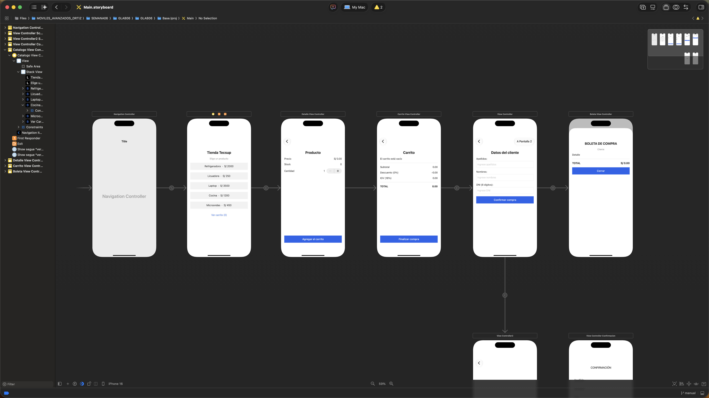
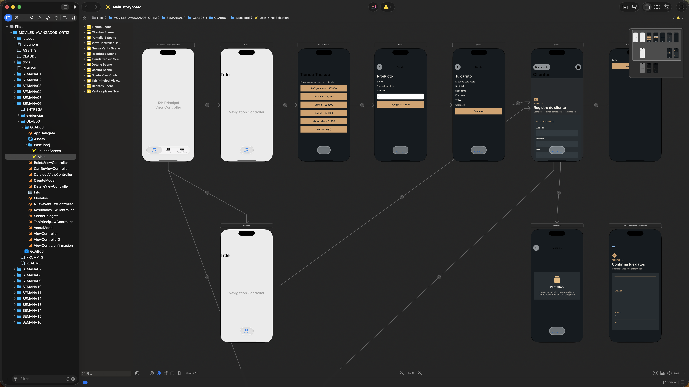
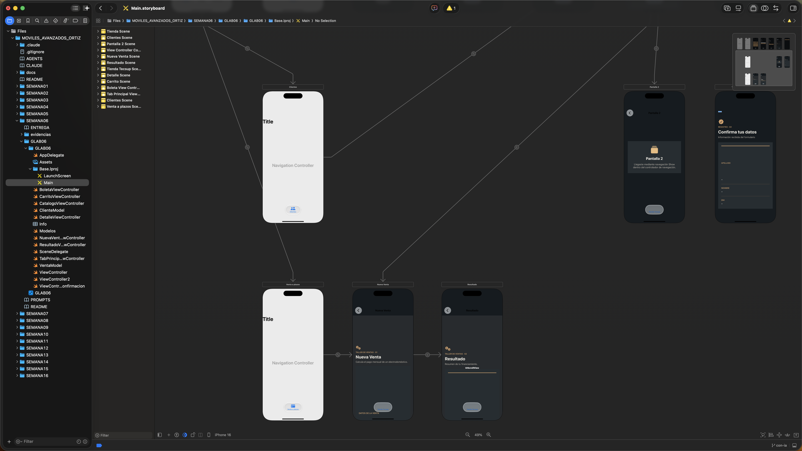

# Semana 06 — Gestión de vistas y navegación (UIKit)

El código **no está en `main`**: `main` solo guarda esta guía de navegación.
La semana tiene **dos tipos de trabajo**, cada uno en su propia rama, sobre el mismo proyecto `GLAB06`.

| Tipo | Rama | Qué contiene |
|---|---|---|
| Manual (sin IA) | `manual` | Navegación `Show`, `ClienteModel`, formulario de cliente, modal de confirmación |
| Con IA | `con-ia` | Lo anterior + rediseño visual, Ejercicio 4 (venta a plazos: `VentaModel`, Nueva Venta, Resultado), App Icon, `PROMPTS.md`, `ENTREGA.md` |

Ruta del proyecto en ambas ramas: `SEMANA06/GLAB06/GLAB06.xcodeproj`

## Ver el trabajo manual

```bash
git switch manual
open SEMANA06/GLAB06/GLAB06.xcodeproj
```

## Ver el trabajo con IA

```bash
git switch con-ia
open SEMANA06/GLAB06/GLAB06.xcodeproj
```

Documentación adicional (solo en `con-ia`): `SEMANA06/README.md` (comparativa y conclusiones), `PROMPTS.md` (prompts y reflexión) y `ENTREGA.md` (checklist de entrega).

## Ver ambas versiones a la vez

```bash
git worktree add ../GLAB06-manual manual
git worktree add ../GLAB06-con-ia con-ia
open ../GLAB06-manual/SEMANA06/GLAB06/GLAB06.xcodeproj
open ../GLAB06-con-ia/SEMANA06/GLAB06/GLAB06.xcodeproj
```

Al terminar: `git worktree remove ../GLAB06-manual && git worktree remove ../GLAB06-con-ia`

## Estructura del Storyboard (segues)

El flujo visual de la app está en `Main.storyboard`, que vive en la rama `manual` (y en `con-ia` al integrar el caso). Cada flecha del canvas es un **segue**.

### Cómo acceder a la estructura

```bash
git switch manual
open SEMANA06/GLAB06/GLAB06.xcodeproj
```

1. En el navegador de archivos abrir `GLAB06 > Base.lproj > Main.storyboard`.
2. Ver todo el flujo: `Editor > Canvas > Zoom to Fit` (o el botón de zoom abajo al centro).
3. Ver las escenas en lista: botón **Document Outline** (abajo a la izquierda del canvas).
4. Ver un segue: clic sobre el círculo de la flecha y abrir el **Attributes Inspector** (Identifier, Kind, Presentation).
5. Ver los enlaces de un botón: clic en el botón y abrir el **Connections Inspector** (acciones `Touch Up Inside` y outlets).

### Captura del Storyboard



### Storyboard de la versión con IA (`con-ia`)

En `con-ia` el Storyboard integra todo el trabajo de la semana en una sola app. Un **Tab Bar Controller** es la pantalla inicial y reparte el flujo en tres pestañas, cada una con su propio Navigation Controller:

| Pestaña | Contenido | Segues |
|---|---|---|
| **Tienda** | Caso integrador: Catálogo, Detalle, Carrito y Boleta | `verDetalle`, `verCarrito`, `irDatosCliente`, `verBoleta` (modal) |
| **Clientes** | Registro de cliente y confirmación (flujo del ejercicio anterior) | Show hacia "Pantalla 2" y confirmación |
| **Venta a plazos** | Ejercicio 4: Nueva Venta y Resultado | Show `showResultado` |

La captura se divide en dos partes porque el canvas es grande: la parte superior muestra la barra de pestañas y las escenas de Tienda y Clientes; la inferior, la pestaña "Venta a plazos" (Nueva Venta → Resultado).

**Parte superior** (Tab Principal, Tienda, Clientes):



**Parte inferior** (Clientes y Venta a plazos):



Diferencias frente a `manual`: la app arranca en la barra de pestañas en lugar del Catálogo, el diseño es oscuro con acentos dorados, y las pestañas permiten usar el caso integrador y el Ejercicio 4 sin salir de la app. La lógica del caso integrador (modelos, descuentos, IGV, categoría, stock) es la misma que en `manual`.

### Mapa del flujo

```
Navigation Controller ──root──▶ Catálogo ──verDetalle──▶ Detalle
                                   │
                                   └──verCarrito──▶ Carrito ──irDatosCliente──▶ Datos del cliente ──verBoleta (modal)──▶ Boleta
```

### Tabla de segues

| Identifier | Origen | Destino | Tipo | Cómo se dispara |
|---|---|---|---|---|
| *(relationship)* | Navigation Controller | Catálogo | Root View Controller | Pantalla inicial |
| `verDetalle` | Catálogo | Detalle | Show (push) | Los 5 botones de producto, un solo segue; se distingue por `tag` |
| `verCarrito` | Catálogo | Carrito | Show (push) | Botón "Ver carrito (n)" |
| `irDatosCliente` | Carrito | Datos del cliente | Show (push) | Botón "Finalizar compra" |
| `verBoleta` | Datos del cliente | Boleta | Modal (`pageSheet`) | Botón "Confirmar compra", tras validar los datos |
| *(sin identifier)* | Datos del cliente | Pantalla 2 | Show (push) | Botón "A Pantalla 2" (ejercicio previo) |

La escena **Confirmación** (`ViewControllerConfirmacion`) quedó del ejercicio anterior y no tiene flecha: se instancia por `storyboardIdentifier`.

### Evidencias

Capturas de la estructura y de cómo se creó, en la carpeta `SEMANA06/evidencias/` de las ramas `manual` y `con-ia`:

- `01-canvas-completo.png`: canvas con las escenas y flechas
- `02-document-outline.png`: escenas en el Document Outline
- `03-segue-identifier.png`: un segue con su Identifier
- `04-connections-inspector.png`: conexiones del botón "Ver carrito"
- `02-storyboard-con-ia-parte-superior.png` y `03-storyboard-con-ia-parte-inferior.png`: Storyboard de la rama `con-ia`
- `05-demo-git.png`: `git log --oneline --graph --all` y `git branch -a`

## Compilar desde terminal

```bash
export DEVELOPER_DIR=/Applications/Xcode.app/Contents/Developer
xcodebuild -project SEMANA06/GLAB06/GLAB06.xcodeproj -scheme GLAB06 \
  -sdk iphonesimulator -destination 'generic/platform=iOS Simulator' \
  -derivedDataPath /tmp/GLAB06DD build
```

Volver a esta guía: `git switch main`.
