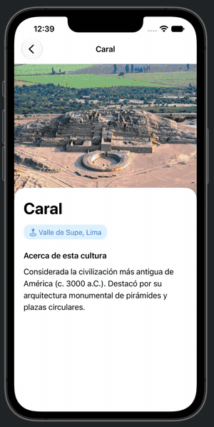

# Semana 07 — Manejo de datos: tablas y colecciones (UIKit)

El código **no está en `main`**: `main` solo guarda esta guía de navegación.
La semana tiene un solo tipo de trabajo, en la rama `manual`, con **tres proyectos** (uno por ejercicio de la guía).

| Parte | Proyecto | Qué contiene |
|---|---|---|
| A | `GLAB07A_Profesores` | `UITableView` con celda `celda` (estilo Subtitle), clase `Profesor`, reuso de celdas, fotos desde Assets |
| B | `GLAB07B_Personas` | Celda personalizada `PersonasTableViewCell` (imagen + label) y alerta en `didSelectRowAt` |
| C | `GLAB07C_Culturas` | Caso a desarrollar: lista de culturas peruanas con foto y pantalla de detalle (imagen, nombre, región, descripción) |

Ruta de los proyectos: `SEMANA07/<proyecto>/<proyecto>.xcodeproj`

## Demo del caso C

Lista de culturas y detalle de cada una (Caral, Chavín, Paracas, Nazca, Moche e Inca):



## Ver el trabajo

```bash
git switch manual
open SEMANA07/GLAB07C_Culturas/GLAB07C_Culturas.xcodeproj   # caso C (cambia el nombre para A o B)
```

Pulsar **Run** (⌘R) con un iPhone como destino.

## Qué ver en el caso C

1. **Storyboard y segue** (`Main.storyboard`): Navigation Controller → lista con celda prototipo → segue `verDetalle` → escena de detalle diseñada con imagen de Assets, color con nombre, tarjeta, iconos y secciones. Usar `Editor > Canvas > Zoom to Fit`.
2. **Información en los controladores**: `CulturasViewController` (nombre, región e imagen de cada fila y envío por el segue) y `DetalleCulturaViewController` (periodo, descripción, aportes y sitios).
3. **Colores**: un color con nombre por cultura en Assets (`AcentoNazca`, `AcentoInca`, etc.), aplicado a la etiqueta de región y a los títulos.
4. **Información ampliada**: Nazca e Inca tienen aportes y sitios emblemáticos.
5. **Fotos**: `Assets.xcassets` (`caral`, `chavin`, `paracas`, `nazca`, `moche`, `inca`).

Detalle de decisiones y borrador de conclusiones: `SEMANA07/README.md` en la rama `manual`.

## Compilar desde terminal

```bash
export DEVELOPER_DIR=/Applications/Xcode.app/Contents/Developer
xcodebuild -project SEMANA07/GLAB07C_Culturas/GLAB07C_Culturas.xcodeproj -scheme GLAB07C_Culturas \
  -sdk iphonesimulator -destination 'generic/platform=iOS Simulator' \
  -derivedDataPath /tmp/GLAB07C_CulturasDD build
```

Volver a esta guía: `git switch main`.
