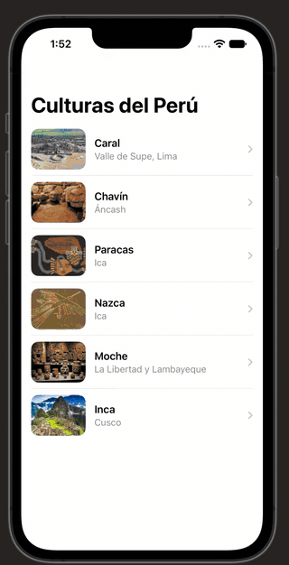
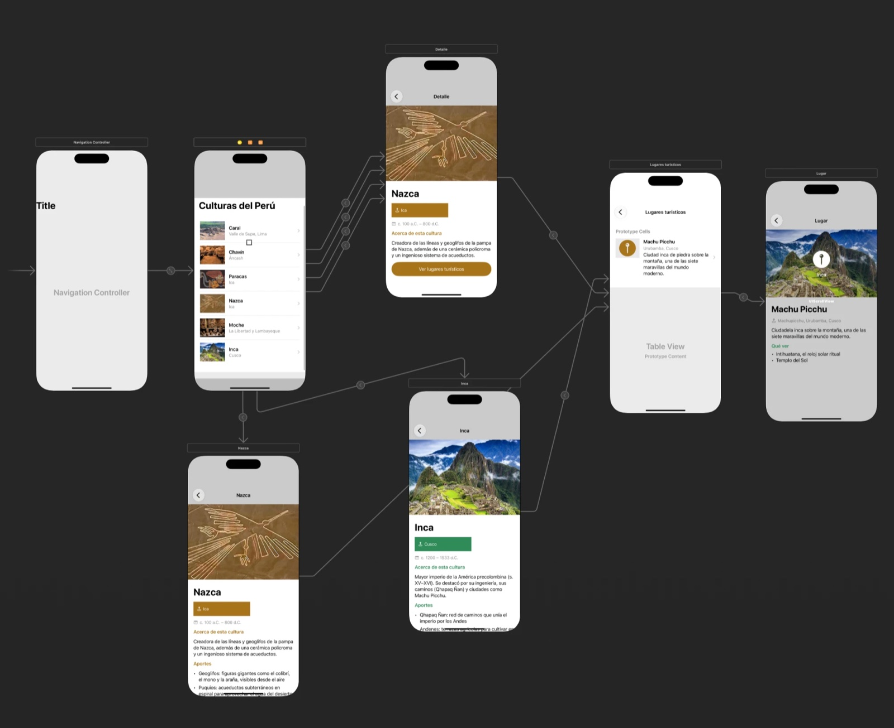

# Semana 08 — Culturas del Perú: tablas, segues y detalle (UIKit)

El código **no está en `main`**: `main` solo guarda esta guía de navegación.
Esta semana **explica lo que apliqué** en el caso de las culturas peruanas. El código no se duplica: vive en la carpeta de la Semana 07 (`SEMANA07/GLAB07C_Culturas`) de la rama `manual`, y aquí se documenta cómo funciona y cómo verlo.

| Tipo | Rama | Ruta del proyecto |
|---|---|---|
| Manual (sin IA) | `manual` | `SEMANA07/GLAB07C_Culturas/GLAB07C_Culturas.xcodeproj` |

## Ver el trabajo

```bash
git switch manual
open SEMANA07/GLAB07C_Culturas/GLAB07C_Culturas.xcodeproj
```

Pulsar **Run** (⌘R) con un iPhone como destino. Volver a esta guía: `git switch main`.

## Cómo se ve la aplicación



## Cómo lo desarrollé

La aplicación tiene un flujo de cuatro niveles: **lista de culturas → detalle de la cultura → lista de lugares turísticos → detalle del lugar**. Lo armé así:

1. **Lista de culturas.** Puse un `UITableView` con una fila por cultura (imagen, nombre y región). Las fotos las guardé en `Assets.xcassets` y las arrastré a cada fila desde el Storyboard.
2. **Segue a cada detalle.** Conecté cada fila con su pantalla de detalle usando un *segue* de tipo **Show** (Control + arrastre). Así no escribo la navegación en código: la flecha del Storyboard ya la define, y le puse un *identifier* a cada una.
3. **Detalle de la cultura.** Diseñé una pantalla con la foto grande, el nombre, la región, el periodo y la descripción. En **Nazca** e **Inca** el detalle es más completo, con aportes y sitios emblemáticos. Para el color de cada cultura creé un *color con nombre* en Assets (por ejemplo `AcentoInca`).
4. **Pasar la información de una pantalla a otra.** La información de las culturas la guardo en los controladores. `CulturasViewController` tiene el nombre, la región y la imagen de cada fila. Cuando el usuario toca una, el segue llama a `prepare(for:sender:)`, que le entrega esos datos a `DetalleCulturaViewController`, y este carga la pantalla.
5. **Lugares turísticos.** En cada detalle agregué un botón "Ver lugares turísticos" con otro segue, que lleva a una lista con los sitios de la zona. `LugaresViewController` guarda los lugares de cada cultura y recibe cuál mostrar.
6. **Detalle del lugar.** Cada lugar de la lista tiene su propio segue hacia una pantalla con la foto, la ubicación, la descripción y qué ver.

Lo que más aprendí fue que el segue evita escribir la navegación a mano y que el Storyboard permite ver todo el recorrido en un solo mapa.

## Los segues en el Storyboard



Cada **flecha** del canvas es un segue. Para verlo en Xcode:

1. Abrir `GLAB07C_Culturas > Base.lproj > Main.storyboard`.
2. `Editor > Canvas > Zoom to Fit` para ver todas las escenas.
3. Clic en el círculo de una flecha y abrir el **Attributes Inspector** (Identifier y Kind).
4. Clic en una celda para ver su *Identifier*, o en una escena (Identity Inspector) para ver su *Storyboard ID*.

### Tabla de segues

| Identifier | Origen | Destino | Cómo se dispara |
|---|---|---|---|
| *(relationship)* | Navigation Controller | Culturas del Perú | Pantalla inicial |
| `verDetalle` | Fila de Caral, Chavín, Paracas o Moche | Detalle básico | Tocar la fila |
| `verNazca` | Fila de Nazca | Detalle de Nazca | Tocar la fila |
| `verInca` | Fila de Inca | Detalle de Inca | Tocar la fila |
| `verLugares` | Botón de cada detalle | Lugares turísticos | Botón "Ver lugares turísticos" |
| `verLugar` | Fila de un lugar | Detalle del lugar | Tocar la fila |

### Identificadores

| Qué | Identificador |
|---|---|
| Celdas de "Culturas del Perú" | `celdaCaral`, `celdaChavin`, `celdaParacas`, `celdaNazca`, `celdaMoche`, `celdaInca` |
| Celda de lugares | `lugarCell` |
| Escenas (Storyboard ID) | `NavegacionCulturas`, `CulturasViewController`, `DetalleCulturaViewController`, `DetalleNazca`, `DetalleInca`, `LugaresViewController`, `LugarDetalleViewController` |

## Compilar desde terminal

```bash
export DEVELOPER_DIR=/Applications/Xcode.app/Contents/Developer
xcodebuild -project SEMANA07/GLAB07C_Culturas/GLAB07C_Culturas.xcodeproj -scheme GLAB07C_Culturas \
  -sdk iphonesimulator -destination 'generic/platform=iOS Simulator' \
  -derivedDataPath /tmp/GLAB07C_CulturasDD build
```
