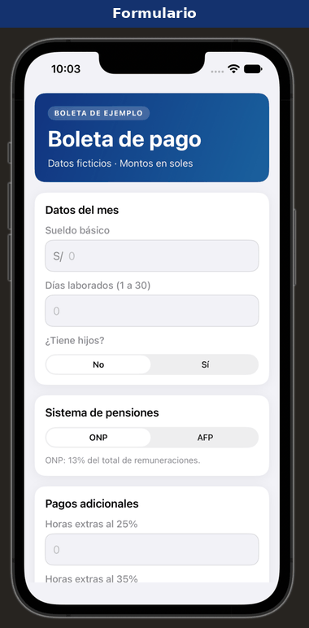
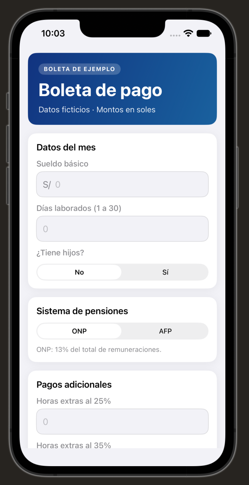
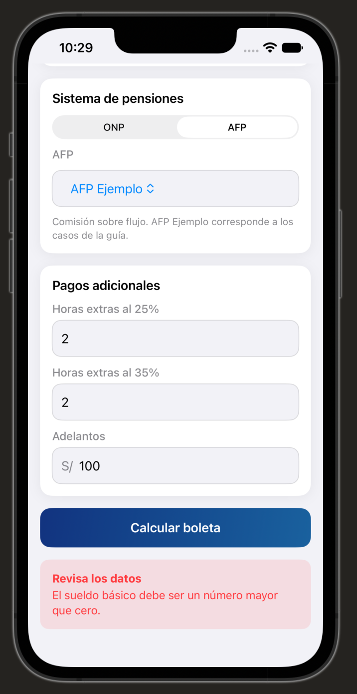
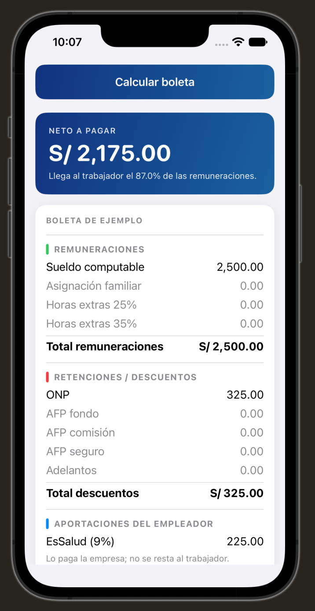
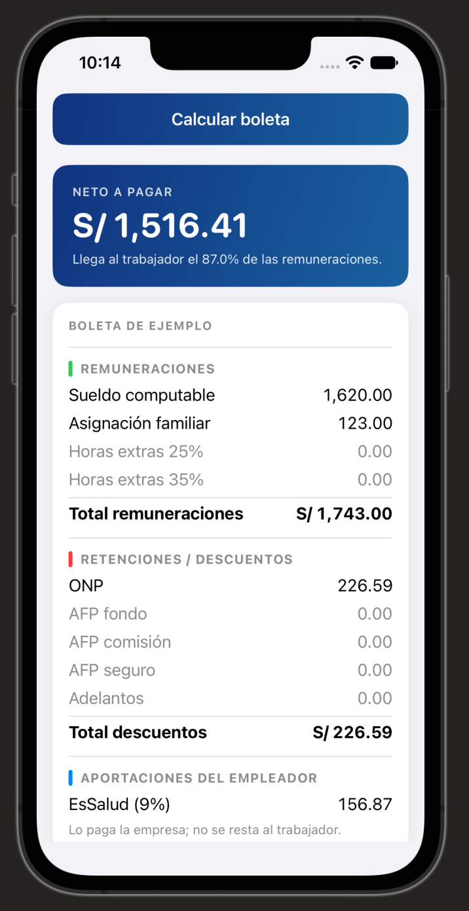
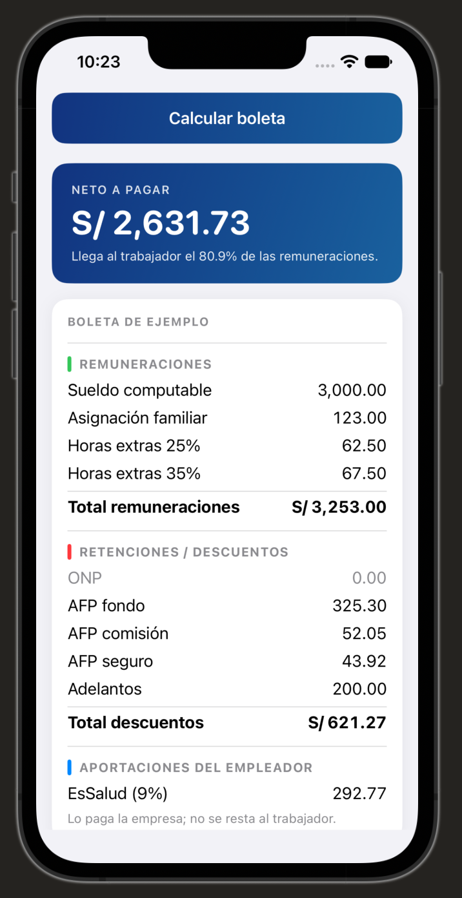
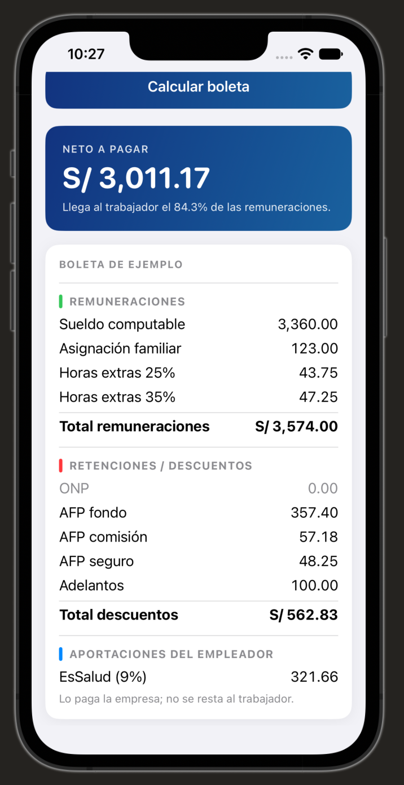

# Semana 09 Boleta de pago en SwiftUI

Aplicación de una pantalla que convierte sueldo, días trabajados, asignación familiar, pensión, horas extras y adelantos en una boleta de ejemplo. El modelo de Swift y el Excel usan los mismos parámetros y redondean cada concepto a dos decimales antes de sumar.

Autor: Jerónimo Ortiz. Incluye contribuciones de Gabriel Haro, conservadas con su autoría en el historial de commits.



## Abrir la aplicación

1. Clonar este repositorio y seleccionar la rama `manual`.
2. En un Mac con Xcode, abrir `SEMANA09/BoletaPago/BoletaPago.xcodeproj` (el proyecto, no la carpeta SEMANA09).
3. Seleccionar el esquema **BoletaPago** y un iPhone del simulador con iOS 17 o posterior.
4. Pulsar **Run**. Ingresar los datos del mes y tocar **Calcular boleta**.
5. Desplazarse hacia abajo para ver remuneraciones, descuentos, aportaciones del empleador y neto.

No requiere servicios externos ni paquetes adicionales para ejecutar la app. Para usar un iPhone físico debe configurarse el equipo de firma de Xcode.

## Uso y validaciones

El sueldo debe ser mayor que cero y los días un entero entre 1 y 30. Horas extras y adelantos no pueden ser negativos; si se dejan vacíos cuentan como cero. Se admite punto o coma decimal, sin separadores de miles. Los adelantos se ingresan con un máximo de dos decimales.

El selector de AFP aparece solo al elegir AFP. Para reproducir los casos 3 y 4 se selecciona **AFP Ejemplo**. Si un dato es inválido, se muestra un mensaje y se retira el resultado anterior.

EsSalud lo paga el empleador y no se descuenta al trabajador. Los conceptos que no aplican permanecen visibles con 0.00 y más tenues. La pantalla dice **Boleta de ejemplo** y no solicita DNI ni RUC.

## Estructura del código

| Archivo o carpeta | Responsabilidad |
|---|---|
| `Modelo/DatosBoleta.swift` | Structs de datos y conceptos, formato monetario y redondeo con Decimal |
| `Modelo/Parametros.swift` | Constantes y diccionario de tasas por AFP |
| `Modelo/Boleta.swift` | Clase Boleta y cálculo de remuneraciones |
| `Modelo/Boleta+Descuentos.swift` | ONP, AFP, adelantos, EsSalud y neto |
| `Modelo/Validacion.swift` | Convierte entradas de texto y devuelve mensajes de error |
| `Vista/ContentView.swift` | Encabezado, formulario en tarjetas y acción Calcular en una sola pantalla |
| `Vista/BoletaView.swift` | Neto destacado y los tres bloques de la boleta; muestra los arrays de conceptos |
| `Vista/Estilo.swift` | Colores, espacios y modificadores de apariencia reutilizables |

Las vistas utilizan Text, VStack, HStack, TextField, Picker, Button, @State y ScrollView. Las fórmulas se mantienen fuera de la pantalla.

## Excel y análisis

Abrir [Boleta_Pago.xlsx](Boleta_Pago.xlsx). Se conservan las cuatro hojas exigidas:

| Hoja | Contenido |
|---|---|
| Parámetros | Tasas, constantes, fuentes oficiales y fecha de consulta |
| Boleta | Entradas amarillas, fórmulas de cálculo y su escritura visible a la derecha |
| Casos | Cuatro casos académicos y control cruzado con Swift y la app |
| Explicación | Cada fórmula en palabras y con un ejemplo numérico del caso 3 |

La explicación del valor hora está anclada al caso 3 y no cambia al modificar el ejemplo de la hoja Boleta. Para ver las fórmulas nativas en Excel también puede usarse **Fórmulas > Mostrar fórmulas**.

Las respuestas 1–4 están en [ANALISIS.md](ANALISIS.md). Las fuentes y los límites del modelo académico están en [FUENTES.md](FUENTES.md). Para preparar la presentación de ambos entregables, seguir [GUIA_EXPOSICION.md](GUIA_EXPOSICION.md).

## Datos de prueba

| Caso | Básico | Días | Hijos | Sistema | Horas 25% / 35% | Adelanto | Neto esperado | Neto en la app |
|---|---:|---:|---|---|---|---:|---:|---:|
| 1 | 2500 | 30 | No | ONP | 0 / 0 | 0 | 2175.00 | 2175.00 |
| 2 | 1800 | 27 | Sí | ONP | 0 / 0 | 0 | 1516.41 | 1516.41 |
| 3 | 3000 | 30 | Sí | AFP Ejemplo | 4 / 4 | 200 | 2631.73 | 2631.73 |
| 4 | 4200 | 24 | Sí | AFP Ejemplo | 2 / 2 | 100 | 3011.17 | 3011.17 |

Los esperados de los casos 1–3 provienen del documento. El esperado del caso 4 es el cálculo independiente del equipo, pendiente de la revisión que el enunciado asigna al docente.

## Repetir las pruebas

Pruebas del modelo sin interfaz, en un Mac:

```bash
swift test --package-path SEMANA09
```

Pruebas de interfaz: abrir el proyecto en Xcode, elegir el esquema BoletaPago y pulsar **Product > Test**. Se ingresan los cuatro casos en la pantalla real y se verifica el neto mostrado. También se comprueba el error de sueldo vacío.

## Alcance de esta entrega

Se desarrollan los niveles 1 y 2. El nivel 3 del documento es un reto opcional y no forma parte de esta versión. El caso propio y la pregunta 5 del análisis permanecen pendientes de una oferta laboral real. La validación del docente y la exposición presencial se realizan fuera del repositorio.

## Capturas de la app ejecutada

Capturas del simulador iPhone 17e, tomadas con la pantalla actual de la app. Los archivos están en [evidencias/simulador](evidencias/simulador). El detalle del control cruzado está en [PRUEBAS.md](PRUEBAS.md).

| Formulario | Mensaje de validación |
|---|---|
|  |  |

| Caso 1, ONP | Caso 2, hijos y 27 días |
|---|---|
|  |  |

| Caso 3, AFP y horas extras | Caso 4, evaluación |
|---|---|
|  |  |
