# SEMANA 11 · Core Data (UIKit) y SwiftData (SwiftUI)

Laboratorio 11: persistencia de datos con CRUD, consultas con filtro y relación de uno a muchos, resuelto con dos tecnologías.

| Parte | Proyecto | Tecnología | Entidades |
|---|---|---|---|
| 1 | [`apple_lab11_01_UIKit_CoreData`](apple_lab11_01_UIKit_CoreData) | UIKit + Storyboard + Core Data | `Contacto`, `Grupo` |
| 2 | [`apple_lab11_02_SwiftUI_SwiftData`](apple_lab11_02_SwiftUI_SwiftData) | SwiftUI + SwiftData | `Alumno`, `Curso` |

Todas las capturas están en [`evidencias/`](evidencias) y se tomaron en el simulador **iPhone 17e (iOS 27.2)**. Ambos proyectos compilan con `** BUILD SUCCEEDED **`.

---

## Parte 1 · Core Data con UIKit (Contacto)

Agenda de contactos con una `UITableView` dentro de un `UINavigationController`. El modelo se define en el editor visual (`.xcdatamodeld`) y el contexto se obtiene de `AppDelegate.persistentContainer.viewContext`.

**Archivos clave**

- `Base.lproj/Main.storyboard`: Navigation Controller, Table View fijada a los 4 bordes, celda `Cell` (Subtitle), botón `+` y título "Lista de Contactos - Tecsup".
- `ViewController.swift`: CRUD completo (leer, crear, editar, borrar).
- `ViewController+Relacion.swift`: búsqueda con `NSPredicate` y relación `Grupo` ↔ `Contacto`.
- `…xcdatamodel`: entidad `Contacto` (nombre, telefono, direccion) y `Grupo` (nombre), relación 1-a-muchos con regla Nullify.

### READ · leer y mostrar los datos

`cargarInfoCoreData()` ejecuta un `NSFetchRequest` ordenado por nombre y la tabla se dibuja desde el arreglo `contactos`.


*La app arranca leyendo los contactos guardados. El simulador ya tenía 2 contactos de pruebas anteriores, que sirven también como prueba de persistencia.*

### CREATE · agregar un contacto

El botón `+` abre un `UIAlertController` con tres campos. `insertNewObject` crea el objeto en el contexto, `contexto.save()` lo escribe en SQLite y `reloadData()` redibuja la tabla.

| Alerta vacía | Alerta con datos | Contacto agregado |
|---|---|---|
| 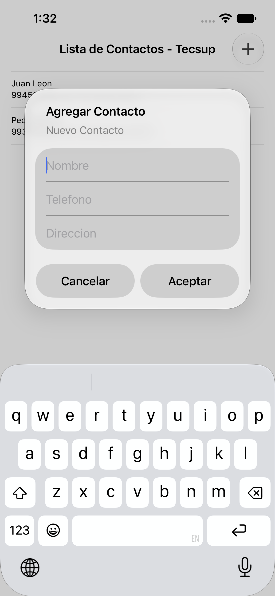 | 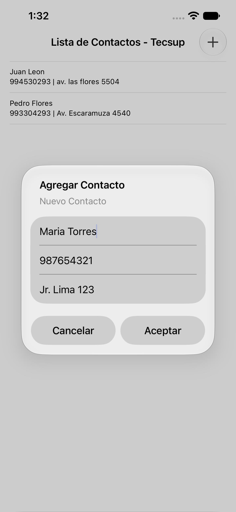 |  |

### UPDATE · editar un contacto

Al tocar una fila se abre una alerta con los datos actuales. Basta cambiar las propiedades del objeto y guardar el contexto.

| Edición (dirección → "Av. Arequipa 456") | Resultado en la tabla |
|---|---|
| 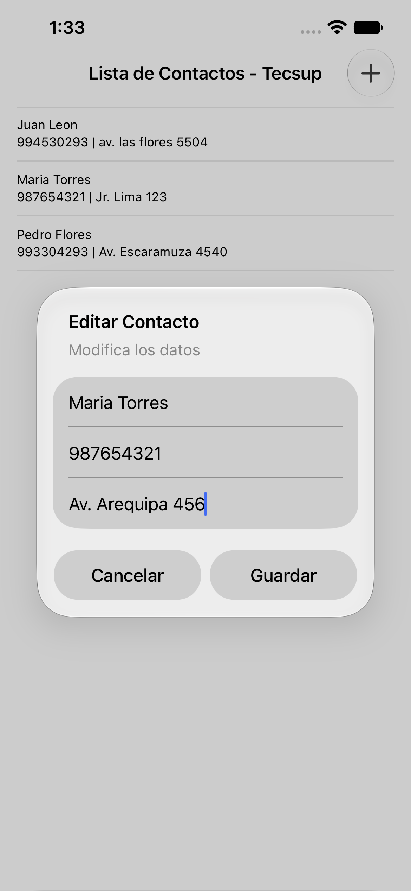 |  |

### DELETE · eliminar un contacto

Deslizar la fila hacia la izquierda muestra *Delete*. `contexto.delete(...)`, `save()` y `deleteRows` quitan el registro del archivo y de la tabla.

| Swipe sobre la fila | Tras eliminar |
|---|---|
|  |  |

### Persistencia

Se detuvo y relanzó la app: los contactos siguen ahí porque vienen del archivo SQLite y no de la memoria.


La consulta directa al archivo SQLite ([`p1-10-sqlite.txt`](evidencias/p1-10-sqlite.txt)) devuelve las mismas filas:

```
Juan Leon|994530293|av. las flores 5504
Pedro Flores|993304293|Av. Escaramuza 4540
```

### Filtro y relación

- `buscarContactos(texto:)` filtra con `NSPredicate(format: "nombre CONTAINS[cd] %@")`.
- `Grupo` y `Contacto` se enlazan con la relación `grupo` / `contactos`. La tabla `ZGRUPO` aparece en la base de datos creada por la app (`.tables` lista `ZCONTACTO` y `ZGRUPO`).
- Las funciones `probarRelacion()` y `contactosDelGrupo(_:)` están implementadas y compilan, pero **no se ejecutaron** en el simulador, por lo que no hay captura de su salida en consola.

---

## Parte 2 · SwiftData con SwiftUI (Alumno)

El mismo problema sin editor de modelo, sin `AppDelegate` y sin `reloadData()`: el modelo es una clase con `@Model` y la vista se actualiza sola con `@Query`.

**Archivos clave**

- `Alumno.swift` y `Curso.swift`: modelos `@Model`. `Curso` tiene `@Relationship(deleteRule: .nullify, inverse: \Alumno.curso)`.
- `ModelContainerProvider.swift`: contenedor singleton que guarda en `AlumnosData.sqlite`.
- `apple_lab11_02_SwiftUI_SwiftDataApp.swift`: conecta el contenedor con `.modelContainer(...)`.
- `ContentView.swift`: lista (`@Query`), detalle, borrado, búsqueda `.searchable` y botón de curso demo.
- `NuevoAlumnoView.swift` y `EditarAlumnoView.swift`: formularios de alta y edición (`@Bindable`).

### READ · lista vacía

`@Query(sort: \Alumno.apellido)` lee los alumnos ordenados por apellido. Sin datos, la lista aparece vacía.

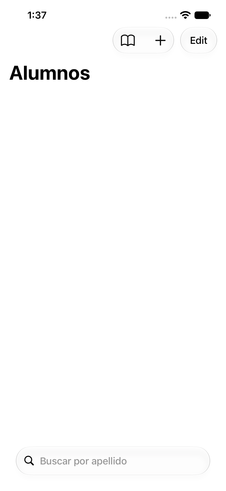

### CREATE · nuevo alumno

El formulario deshabilita *Guardar Alumno* mientras haya un campo vacío (`.disabled(...)`). `modelContext.insert` crea el registro y `modelContext.save()` lo escribe. La lista se actualiza sin código de refresco.

| Formulario vacío (Guardar inactivo) | Formulario lleno (Guardar activo) | Alumno en la lista |
|---|---|---|
| 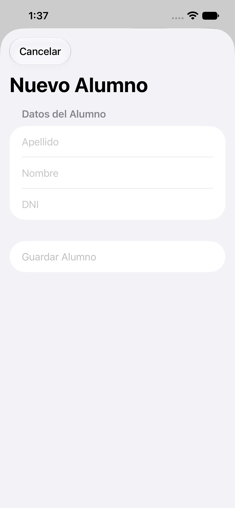 | 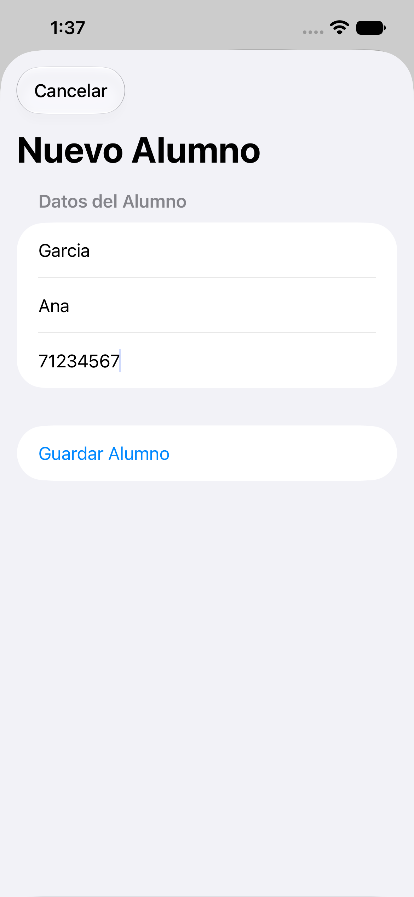 | 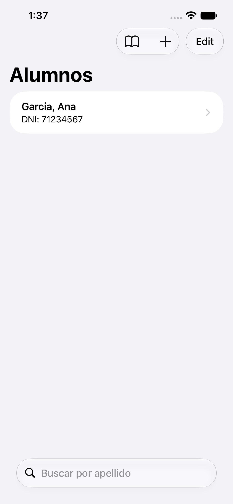 |

Con tres alumnos cargados, la lista queda ordenada por apellido:


### DELETE · eliminar con swipe

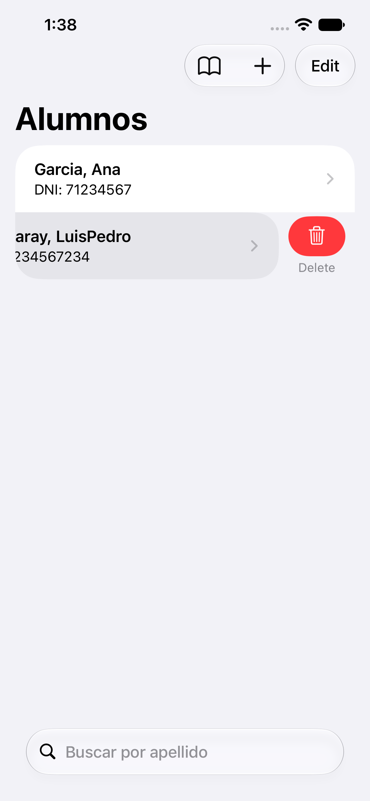

### Detalle y UPDATE · editar un alumno

Al seleccionar un alumno se muestra su detalle (con el curso). *Editar* abre un formulario enlazado con `@Bindable`: al escribir, el objeto cambia y SwiftData lo guarda solo.

Aquí el autocorrector del teclado había cambiado "Garay" por "Gary's", así que se corrigió desde la edición a "Garcia".

| Detalle | Formulario de edición | Detalle actualizado |
|---|---|---|
| 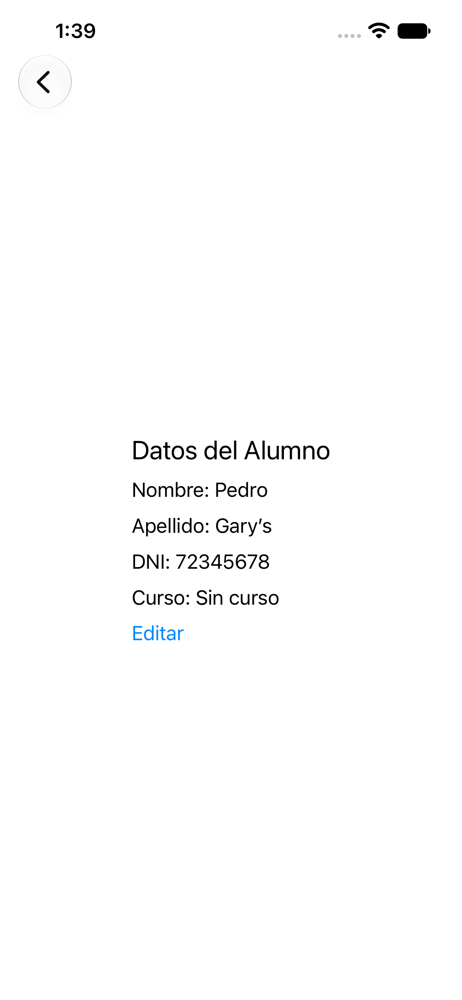 | 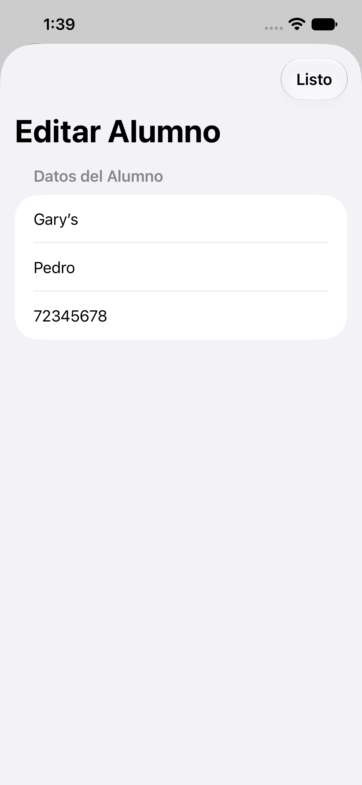 |  |

### Búsqueda con `.searchable`

Al escribir "gar" solo quedan los apellidos que lo contienen; "Lopez" desaparece de la lista.

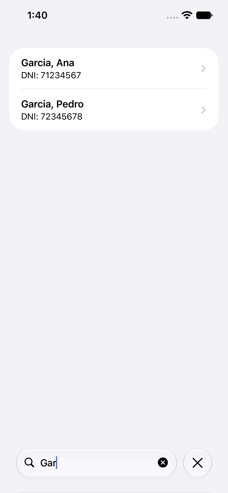

### Relación 1 a muchos: Curso y Alumno

El botón del libro crea el curso "Programación en Móviles" y se lo asigna a todos los alumnos. El detalle pasa de "Sin curso" a mostrar el curso.

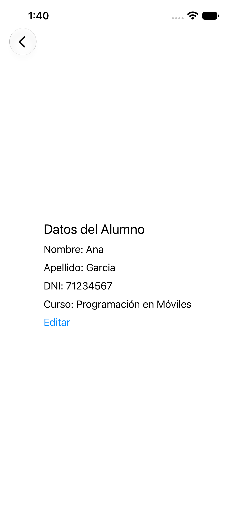

### Persistencia

Tras detener y relanzar la app, los tres alumnos siguen en la lista, con el apellido corregido:

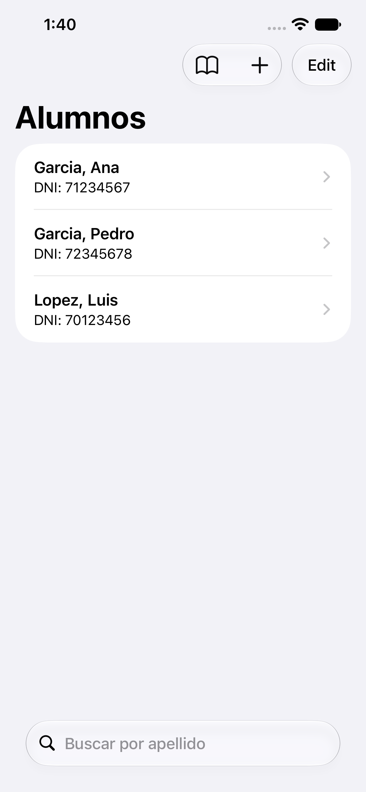

Consulta directa al archivo `AlumnosData.sqlite` ([`p2-13-sqlite.txt`](evidencias/p2-13-sqlite.txt)), con la relación guardada:

```
Garcia|Ana|71234567|Programación en Móviles
Lopez|Luis|70123456|Programación en Móviles
Garcia|Pedro|72345678|Programación en Móviles
```

Y el detalle abierto después del reinicio:

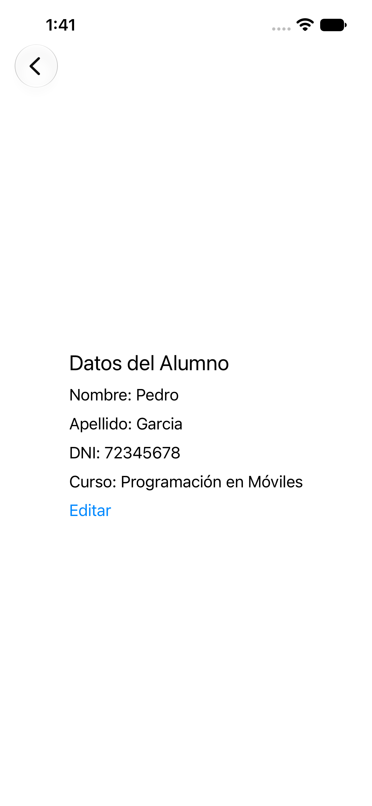

---

## Notas

- **Un `save()` agregado a la guía.** En la primera prueba, la asignación del curso no sobrevivió al reinicio: `asignarCursoDemo()` del PDF no llama a `save()` y la app se cerró antes del autoguardado de SwiftData. Se añadió `try? modelContext.save()` al final de esa función y la relación quedó persistida (ver `p2-13-sqlite.txt`). Es la única diferencia respecto al código de la guía.
- **Destino de iOS.** Ambos proyectos usan iOS 27.2 como destino mínimo, por eso se probaron en el iPhone 17e con iOS 27.2.
- **Parte 3 de la guía** (preguntas de comprensión) y los trabajos de la semana (grupos A y B) no forman parte de estas capturas.
