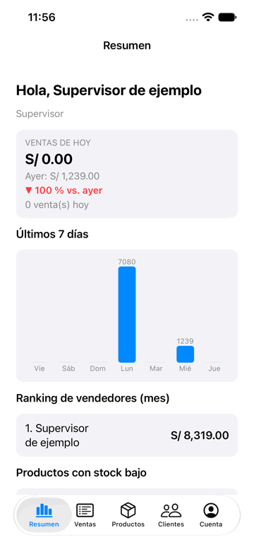
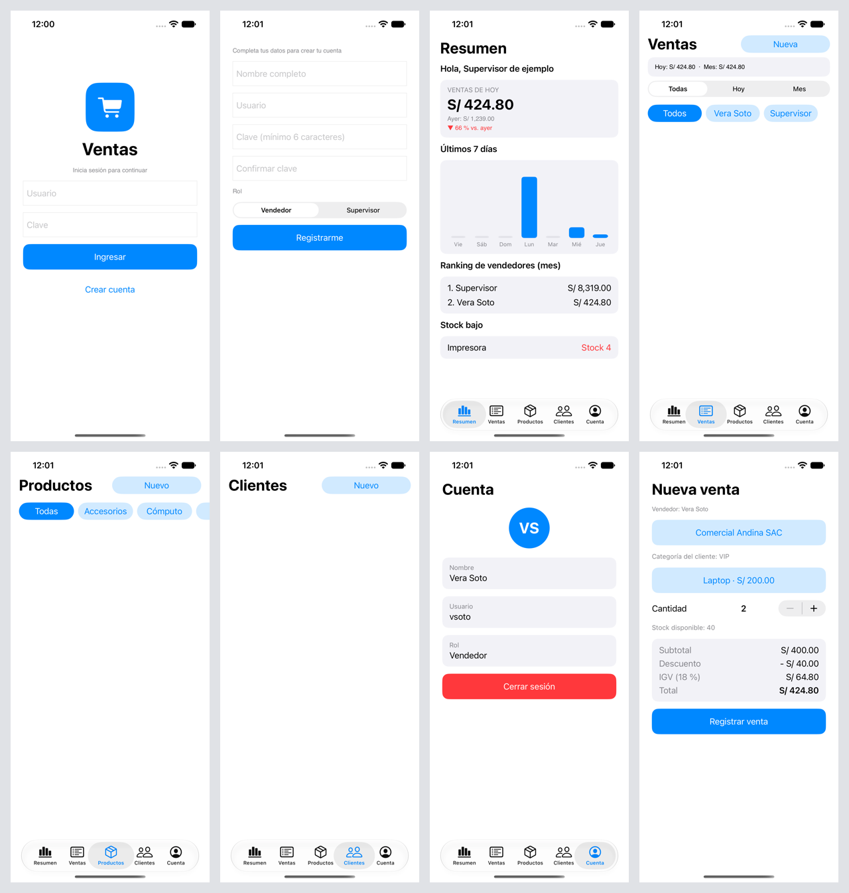

# SEMANA 12 · Grupo A · Ventas con MVVM (UIKit + Core Data)

Refactor de la app Ventas de la SEMANA 11 (Grupo A) al patrón **MVVM**. La app hace lo mismo que antes; cambia dónde vive cada responsabilidad.

> **Trabajo asistido por IA.** Va en la rama `con-ia`, con su registro en [`PROMPTS.md`](PROMPTS.md).

## Demostración

<p align="center">
  
</p>

Recorrido del GIF (simulador iPhone 17e): **1)** panel de Resumen del supervisor, **2)** anular una venta pidiendo motivo, **3)** la venta queda tachada y marcada como ANULADA. Las capturas originales están en [`../evidencias/`](../evidencias).

## Estructura visual: `Main.storyboard`

La interfaz UIKit está diseñada de forma visual en [`Storyboard/Main.storyboard`](apple_lab12_Ventas_MVVM_UIKit_CoreData/Storyboard/Main.storyboard) (Xcode ▸ abrir el archivo). Son **10 escenas**, ordenadas en tres filas de izquierda a derecha:

```
Fila 1   LoginNav ──► Login (A1) ──► Crear cuenta (A2)
                         │ entrar
Fila 2              Barra de pestañas
                         │
Fila 3   Resumen (A9) · Ventas (A6/A7) · Productos (A3) · Clientes (A4) · Cuenta
                          │ "Nueva"
Fila 4              Nueva venta (A5)
```

- **Una sola barra de pestañas** con 5 pestañas. Al iniciar sesión, el código (`MainTabBarController`) muestra las que corresponden a cada rol.
- **A8 · Anular** no es una pantalla: es una alerta que se abre al deslizar una venta.
- Componentes UIKit: `UINavigationController`, `UITabBarController`, `UITableView` con celdas prototipo, `UIStackView`, `UISegmentedControl`, `UIStepper` y *segues*. Cada escena lleva como etiqueta el nombre de su clase (`LoginViewController`, `VentasViewController`…).
- Los marcos de cada vista se calcularon con Auto Layout, así que el lienzo de Xcode se ve igual que en el simulador. `ibtool` lo valida sin errores ni avisos.

<p align="center"></p>

> **Alcance.** El storyboard define el diseño y la navegación. Al ejecutar, las pantallas siguen construyéndose desde los ViewControllers de `Views/` (todavía sin `@IBOutlet`/`@IBAction`). Por eso, en ejecución el vendedor ve "Nueva venta" como pestaña propia, y las listas muestran sus celdas prototipo solo en el lienzo de Xcode.

## Estructura

```
apple_lab12_Ventas_MVVM_UIKit_CoreData/
├── App/            AppDelegate, SceneDelegate (arranque y cambio login ⇄ app)
├── Modelo/         Modelo Core Data (.xcdatamodeld) y Reglas.swift (fórmulas de negocio)
├── Servicios/      Datos (acceso a Core Data), Sesion (usuario conectado), SeedData
├── ViewModels/     Un ViewModel por pantalla: estado, validación y reglas de la pantalla
├── Storyboard/     Main.storyboard: estructura visual y navegación
├── Views/          ViewControllers: solo UI y enlace con su ViewModel
└── Utilidades/     Formato de moneda y fechas, estilos
```

## Quién hace qué

| Capa | Qué contiene | Qué NO hace |
|---|---|---|
| **Model** | Entidades Core Data (`Usuario`, `Producto`, `Cliente`, `Venta`) y `Reglas` (descuento, IGV, categoría) | No conoce pantallas |
| **ViewModel** | Consultas con `NSPredicate`, validaciones, textos ya formateados, permisos por rol, guardar/borrar/anular | No importa `UIKit`; no crea vistas |
| **View** | Construye la interfaz y pinta lo que le da el ViewModel; reenvía las acciones del usuario | No toca Core Data ni calcula reglas |

Comprobación: dentro de `Views/` no aparece `Datos.`, `NSPredicate`, `NSFetchRequest`, `import CoreData` ni `Reglas.` (se verificó con `grep`).

## Cómo se enlaza la vista con el ViewModel

Sin librerías externas: el ViewModel expone `onChange`, la vista se suscribe y se redibuja.

```swift
// ViewModel
var onChange: (() -> Void)?
func recargar() { /* consulta */ onChange?() }

// View
viewModel.onChange = { [weak self] in self?.tabla.reloadData() }
```

Las acciones hacen el camino inverso: la vista llama a un método del ViewModel (`viewModel.ingresar(usuario:clave:)`) y este devuelve `nil` si salió bien o el mensaje de error.

## Pantallas y su ViewModel

| Pantalla | View | ViewModel |
|---|---|---|
| A1 Login | `LoginViewController` | `LoginViewModel` |
| A2 Crear cuenta | `RegistroViewController` | `RegistroViewModel` |
| A3 Productos | `ProductosViewController` | `ProductosViewModel` + `ProductoFormViewModel` |
| A4 Clientes | `ClientesViewController` | `ClientesViewModel` + `ClienteFormViewModel` |
| A5 Nueva venta | `NuevaVentaViewController` | `NuevaVentaViewModel` |
| A6/A7/A8 Ventas y anulación | `VentasViewController` | `VentasViewModel` |
| A9 Resumen | `ResumenViewController` | `ResumenViewModel` |
| Cuenta | `CuentaViewController` | `CuentaViewModel` |

## Qué cambió respecto a la SEMANA 11

- Los ViewControllers pasaron de mezclar UI, consultas y reglas a solo UI. La lógica (unas 600 líneas) está ahora en `ViewModels/`.
- El nivel de stock lo decide el ViewModel (`NivelStock`) y la vista elige el color; igual con la `Tendencia` del resumen.
- Las filas de las listas son estructuras simples (`ProductoFila`, `ClienteFila`, `VentaFila`) en lugar de objetos de Core Data.
- Los datos, las reglas de negocio y el comportamiento de la app no cambiaron.

## Verificación

- `xcodebuild` termina en `BUILD SUCCEEDED`.
- Probado en el simulador iPhone 17e (iOS 27.2): login del supervisor, Resumen, lista de Ventas y **anulación con motivo** (la venta queda tachada y el stock sube de 60 a 90; ver [`../evidencias/`](../evidencias)).
- **No se repitió en pantalla** el flujo del vendedor (Nueva venta, Mis ventas) ni Productos y Clientes tras el refactor: compilan y siguen el mismo código de la SEMANA 11, pero no se ejercitaron de nuevo. Los casos de prueba completos de la app están en la SEMANA 11 (`PRUEBAS.md`).

## Cómo abrirlo

```bash
open apple_lab12_Ventas_MVVM_UIKit_CoreData/apple_lab12_Ventas_MVVM_UIKit_CoreData.xcodeproj
```

Usuario de ejemplo del supervisor: `supervisor` / `123456` (datos de `SeedData.swift`). Requiere iOS 27.2.
